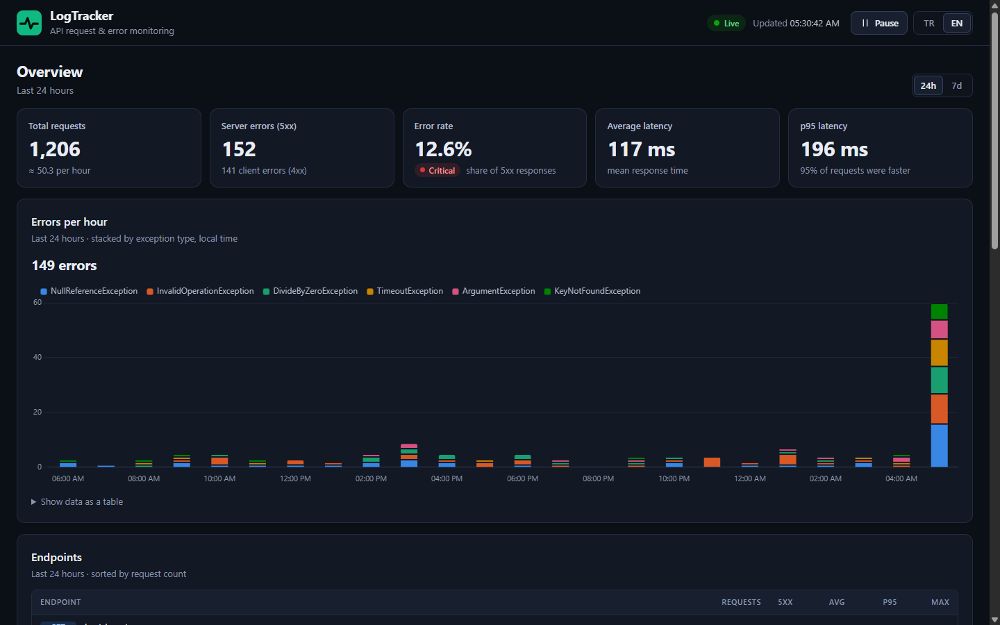
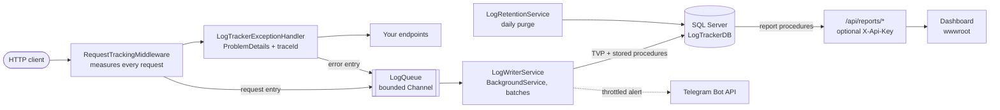

# LogTracker

**Request timing, exception logging and live reports for ASP.NET Core APIs, backed by SQL Server.**

[](https://github.com/ibrahimceceli/LogTrackerAPI/actions/workflows/ci.yml)
[](https://dotnet.microsoft.com/)
[](LICENSE)

**English** · [Türkçe](README.tr.md)



LogTracker is a small library you add to an ASP.NET Core app with three calls. It measures every API
request, records unhandled exceptions with their stack traces, writes both to SQL Server in the
background and serves the results through a reports API and a live dashboard. Optional Telegram
alerts tell you when something breaks.

The repository contains the library, a demo API to try it on, a traffic simulator, the SQL scripts,
tests and a Docker Compose stack that runs everything with one command.

## Features

- **Request tracking**: method, route template (`/api/products/{id:int}`, not `/api/products/7`),
  path, status code, duration and W3C trace id for every request.
- **Exception logging**: unhandled exceptions are stored with type, message, source class and full
  stack trace, and answered with a [ProblemDetails](https://www.rfc-editor.org/rfc/rfc9457) body that
  carries the same `traceId`.
- **Never slows requests down**: entries go into a bounded in-memory queue; a background service writes
  them in batches through table-valued parameters. If the database is down, requests keep working.
- **Reports API**: summary with error rate, average and p95 latency, paged request and error lists,
  per-endpoint statistics, errors per hour, and a weekly latency trend built with `PIVOT`.
- **Live dashboard**: dark, responsive, English/Turkish, Chart.js charts, refreshes every 5 seconds.
  XSS-safe (all values rendered as text, strict Content Security Policy).
- **Telegram alerts** for unhandled exceptions, HTML-escaped and throttled per exception type.
- **Housekeeping**: daily retention purge, database health check on `/health`, optional `X-Api-Key`
  protection for the reports.
- **Ready to run**: Docker Compose stack with SQL Server and demo data, traffic simulator, unit/API/database
  tests and GitHub Actions CI.

## Contents

- [Architecture](#architecture)
- [Quick start with Docker](#quick-start-with-docker)
- [Running locally without Docker](#running-locally-without-docker)
- [Using LogTracker in your own app](#using-logtracker-in-your-own-app)
- [Configuration](#configuration)
- [API reference](#api-reference)
- [Database](#database)
- [Testing and CI](#testing-and-ci)
- [Security notes](#security-notes)
- [Background](#background)
- [License](#license)

## Architecture



A request passes through the tracking middleware, which wraps the exception handler, so it also sees
the final status code of failed requests. Both only add entries to an in-memory queue and return
immediately. `LogWriterService` reads the queue and inserts whole batches with one stored procedure call
per table. If the queue is ever full, new entries are dropped and counted instead of blocking requests.
On shutdown the remaining entries are flushed.

### Project layout

```text
LogTrackerAPI/
├── src/
│   ├── LogTracker.Core/        Reusable library: middleware, exception handler, queue, writer, reports, alerts
│   ├── LogTracker.Api/         Demo host: products/orders endpoints, test endpoints, dashboard in wwwroot
│   └── LogTracker.Simulator/   Console app that sends realistic demo traffic to the API
├── database/                   Idempotent, numbered SQL scripts (tables, types, procedures, demo data)
├── tests/
│   ├── LogTracker.Core.Tests/  Unit tests and SQL Server tests for the library
│   └── LogTracker.Api.Tests/   API tests with WebApplicationFactory
├── docs/images/                Screenshots used in this README
├── Dockerfile                  Multi-stage build for the API and simulator images
├── docker-compose.yml          SQL Server + schema + API (+ simulator with --profile demo)
└── .github/workflows/ci.yml    Build, test, database tests and Docker smoke test
```

## Quick start with Docker

You only need [Docker](https://docs.docker.com/get-docker/) with Docker Compose. No .NET SDK or local
SQL Server is required.

```bash
git clone https://github.com/ibrahimceceli/LogTrackerAPI.git
cd LogTrackerAPI
cp .env.example .env
```

Open `.env` and set your own `MSSQL_SA_PASSWORD` (at least 8 characters from three of: uppercase,
lowercase, digits, symbols; avoid `;`, `'`, `"`, `$` and spaces). Then start the stack:

```bash
docker compose up --build
```

Compose starts SQL Server, waits until it is healthy, runs the scripts in `database/` (including the
demo data, so the dashboard is not empty) and starts the API. To also start the traffic simulator:

```bash
docker compose --profile demo up --build
```

| What | Where |
| --- | --- |
| Dashboard | <http://localhost:8080> |
| Reports API | <http://localhost:8080/api/reports/summary> |
| Health check | <http://localhost:8080/health> |
| SQL Server (SSMS, Azure Data Studio, sqlcmd) | `127.0.0.1,14333`, user `sa`, password from `.env` |

All ports are bound to `127.0.0.1` only. Change them with `API_PORT` and `DB_PORT` in `.env`.
In the container the app runs in the Production environment, so the OpenAPI document and Scalar are not
served there (see [Running locally](#running-locally-without-docker)).

Stop and clean up:

```bash
docker compose --profile demo down            # stop and remove the containers, keep the database
docker compose --profile demo down --volumes  # also delete the database volume
```

### Settings in `.env`

| Variable | Default | Meaning |
| --- | --- | --- |
| `MSSQL_SA_PASSWORD` | `LogTracker_Dev_2026` | Password of the `sa` login (required; pick your own) |
| `DB_PORT` | `14333` | Host port for SQL Server |
| `API_PORT` | `8080` | Host port for the API and dashboard |
| `LOGTRACKER_API_KEY` | empty | When set, `/api/reports/*` requires the `X-Api-Key` header |
| `TELEGRAM_ENABLED` | `false` | Turns Telegram alerts on |
| `TELEGRAM_BOT_TOKEN` / `TELEGRAM_CHAT_ID` | empty | Bot token from @BotFather and the receiving chat id |
| `SIMULATOR_CONCURRENCY` | `4` | Virtual users sending requests in parallel (1-50) |
| `SIMULATOR_MIN_DELAY_MS` / `SIMULATOR_MAX_DELAY_MS` | `200` / `1500` | Random pause between two requests of one user |
| `SIMULATOR_ERROR_PERCENT` | `10` | Share of requests sent to the failing test endpoint |
| `SIMULATOR_DURATION_SECONDS` | empty | Stop after N seconds; empty runs until the stack stops |
| `SIMULATOR_SUMMARY_INTERVAL_SECONDS` | `30` | Seconds between summaries in the simulator log; `0` = final summary only |

`.env` is git-ignored. Never commit real passwords or tokens.

## Running locally without Docker

### Prerequisites

- [.NET 10 SDK](https://dotnet.microsoft.com/download) (the version is pinned in `global.json`)
- SQL Server 2019 or newer, or **SQL Server Express LocalDB** (installed with Visual Studio)
- [`sqlcmd`](https://learn.microsoft.com/sql/tools/sqlcmd/sqlcmd-utility) to run the scripts

### 1. Create the database

The Development settings (`src/LogTracker.Api/appsettings.Development.json`) point at LocalDB:

```text
Server=(localdb)\MSSQLLocalDB;Database=LogTrackerDB;Trusted_Connection=True;TrustServerCertificate=True
```

Create `LogTrackerDB` and run the scripts in name order. The scripts are idempotent, so you can run them
again after pulling changes. `90_seed_demo_data.sql` is optional; it adds about a week of demo traffic
and only runs when the tables are empty.

PowerShell:

```powershell
sqlcmd -S "(localdb)\MSSQLLocalDB" -Q "IF DB_ID(N'LogTrackerDB') IS NULL CREATE DATABASE [LogTrackerDB];"
Get-ChildItem database\*.sql | Sort-Object Name | ForEach-Object { sqlcmd -S "(localdb)\MSSQLLocalDB" -d LogTrackerDB -b -I -i $_.FullName }
```

Bash:

```bash
sqlcmd -S "(localdb)\MSSQLLocalDB" -Q "IF DB_ID(N'LogTrackerDB') IS NULL CREATE DATABASE [LogTrackerDB];"
for f in database/*.sql; do sqlcmd -S "(localdb)\MSSQLLocalDB" -d LogTrackerDB -b -I -i "$f"; done
```

For another SQL Server, replace `-S "(localdb)\MSSQLLocalDB"` with your server (and `-U`/`-P` for SQL
logins, `-C` to trust a self-signed certificate).

### 2. Configure secrets (optional)

The connection string above works out of the box with LocalDB. For anything else, keep settings out of
the repository with [user secrets](https://learn.microsoft.com/aspnet/core/security/app-secrets):

```bash
dotnet user-secrets set "ConnectionStrings:LogTrackerDb" "Server=localhost;Database=LogTrackerDB;User Id=...;Password=...;TrustServerCertificate=True" --project src/LogTracker.Api
dotnet user-secrets set "LogTracker:ApiKey" "choose-a-long-random-value" --project src/LogTracker.Api
dotnet user-secrets set "LogTracker:Telegram:Enabled" "true" --project src/LogTracker.Api
dotnet user-secrets set "LogTracker:Telegram:BotToken" "123456:ABC..." --project src/LogTracker.Api
dotnet user-secrets set "LogTracker:Telegram:ChatId" "123456789" --project src/LogTracker.Api
```

### 3. Run the API

```bash
dotnet dev-certs https --trust        # once, so the browser and the simulator trust https://localhost
dotnet run --project src/LogTracker.Api --launch-profile https
```

| What | Where |
| --- | --- |
| Dashboard | <https://localhost:7292> |
| Scalar API reference (Development only) | <https://localhost:7292/scalar> |
| OpenAPI document (Development only) | <https://localhost:7292/openapi/v1.json> |
| Plain HTTP | <http://localhost:5269> (also the default of `dotnet run` without `--launch-profile`) |

`src/LogTracker.Api/LogTracker.Api.http` contains ready-made requests for Visual Studio, Rider and the
VS Code REST Client.


### 4. Generate traffic with the simulator

In a second terminal:

```bash
dotnet run --project src/LogTracker.Simulator
```

The default target is `https://localhost:7292`. Useful options (each also has an environment variable):

```bash
dotnet run --project src/LogTracker.Simulator -- --base-url http://localhost:5269 --concurrency 8 --error-percent 20 --duration 60
dotnet run --project src/LogTracker.Simulator -- --help
```

| Option | Environment variable | Default |
| --- | --- | --- |
| `--base-url <url>` | `SIMULATOR_BASE_URL` | `https://localhost:7292` |
| `--concurrency <n>` | `SIMULATOR_CONCURRENCY` | `4` (1-50) |
| `--min-delay <ms>` | `SIMULATOR_MIN_DELAY_MS` | `200` |
| `--max-delay <ms>` | `SIMULATOR_MAX_DELAY_MS` | `1500` |
| `--error-percent <0-100>` | `SIMULATOR_ERROR_PERCENT` | `10` |
| `--duration <seconds>` | `SIMULATOR_DURATION_SECONDS` | none (run until Ctrl+C) |
| `--summary-interval <seconds>` | `SIMULATOR_SUMMARY_INTERVAL_SECONDS` | `30` (`0` = final summary only) |

The simulator calls the product and order endpoints (including some unknown ids and invalid orders),
slow requests and the failing test endpoints. It stops on Ctrl+C and prints a summary. Exit codes:
`0` success, `1` the API never answered, `2` invalid options. Set `NO_COLOR=1` to disable colors.

## Using LogTracker in your own app

`LogTracker.Core` is a class library (not published to NuGet). Reference the project, run the scripts
`01`-`05` from `database/` against your database, and add three calls:

```xml
<ProjectReference Include="..\LogTracker.Core\LogTracker.Core.csproj" />
```

```csharp
using LogTracker.Core;

var builder = WebApplication.CreateBuilder(args);

// Tracking, exception handler, ProblemDetails, background writer, retention, alerts, health check.
builder.Services.AddLogTracker(builder.Configuration);

var app = builder.Build();

app.UseStaticFiles();    // optional; static files served before UseLogTracker are not tracked
app.UseLogTracker();     // request tracking + exception handler, before your endpoints

app.MapHealthChecks("/health");   // includes the "logtracker-database" check
app.MapLogTrackerReports();       // GET /api/reports/*

app.MapGet("/hello", () => "Hello!");

app.Run();
```

```json
{
  "ConnectionStrings": {
    "LogTrackerDb": "Server=...;Database=LogTrackerDB;..."
  },
  "LogTracker": {
    "RetentionDays": 30
  }
}
```

`MapLogTrackerReports()` returns the `RouteGroupBuilder`, so you can protect the reports with your own
authentication instead of (or in addition to) the API key, for example
`app.MapLogTrackerReports().RequireAuthorization();`. To show the dashboard, copy `index.html`, `css/`,
`js/` and `lib/` from `src/LogTracker.Api/wwwroot` into your app's `wwwroot` and call
`app.UseDefaultFiles()` before `app.UseStaticFiles()`.

The settings are validated at startup: a missing connection string, an invalid value or Telegram enabled
without token and chat id stops the app with a clear message instead of failing later.

## Configuration

All settings live in the `LogTracker` section, except the connection string. As environment variables,
`:` becomes `__` (double underscore).

| Setting | Default | Environment variable | Meaning |
| --- | --- | --- | --- |
| `ConnectionStrings:LogTrackerDb` | (required) | `ConnectionStrings__LogTrackerDb` | SQL Server connection string |
| `LogTracker:ApiKey` | empty | `LogTracker__ApiKey` | When set (at least 16 characters), report requests need `X-Api-Key: <value>`; empty = open |
| `LogTracker:RetentionDays` | `30` | `LogTracker__RetentionDays` | Rows older than this are deleted at startup and then once a day |
| `LogTracker:ExcludedPathPrefixes` | see below | `LogTracker__ExcludedPathPrefixes__0`, `__1`, ... | Extra path prefixes that are not tracked (added to the defaults; must start with `/`) |
| `LogTracker:QueueCapacity` | `10000` | `LogTracker__QueueCapacity` | Entries that may wait for the writer; when full, new entries are dropped |
| `LogTracker:BatchSize` | `500` | `LogTracker__BatchSize` | Maximum entries per database round trip |
| `LogTracker:Telegram:Enabled` | `false` | `LogTracker__Telegram__Enabled` | Turns Telegram alerts on |
| `LogTracker:Telegram:BotToken` | empty | `LogTracker__Telegram__BotToken` | Bot token from @BotFather (required when enabled) |
| `LogTracker:Telegram:ChatId` | empty | `LogTracker__Telegram__ChatId` | Chat that receives alerts (required when enabled) |
| `LogTracker:Telegram:ThrottleSeconds` | `60` | `LogTracker__Telegram__ThrottleSeconds` | At most one alert per exception type in this window; skipped alerts are counted in the next one; `0` sends all |
| `LogTracker:EnableTestEndpoints` | `false` | `LogTracker__EnableTestEndpoints` | Demo API only: maps `/api/test/*` (on in Development and in Docker Compose) |

Paths that are never tracked by default: `/api/reports`, `/health`, `/swagger`, `/openapi`, `/scalar`,
`/favicon.ico`, `/.well-known`. Static files that are served successfully are not tracked either.
Requests that match no route are tracked with the endpoint `(unmatched)`.

## API reference

### Reports

All report endpoints are `GET` requests under `/api/reports`. When `LogTracker:ApiKey` is set they need
the `X-Api-Key` header and answer `401` otherwise. Invalid parameters return `400` with a
`ValidationProblemDetails` body. Times are UTC.

| Endpoint | Parameters | Returns |
| --- | --- | --- |
| `/api/reports/summary` | `hours` = 24 (1-8784) | Totals, 4xx/5xx counts, error rate, average and p95 duration |
| `/api/reports/requests` | `page` = 1, `pageSize` = 20 (1-100) | Tracked requests, newest first |
| `/api/reports/errors` | `page` = 1, `pageSize` = 20 (1-100) | Unhandled exceptions, newest first (without stack trace) |
| `/api/reports/errors/{id}` | | One exception including its stack trace; `404` if unknown |
| `/api/reports/endpoints` | `hours` = 168 (1-8784) | Requests, 5xx count, average/p95/max duration per method and route, busiest first |
| `/api/reports/hourly-errors` | `hours` = 24 (1-8784) | Error count per hour and exception type; hours without errors are left out |
| `/api/reports/weekly-trend` | | Average duration per endpoint and weekday over the last 7 UTC days; `null` = no requests |

`GET /api/reports/summary?hours=24`

```json
{
  "from": "2026-10-29T02:29:06.1664706Z",
  "to": "2026-10-30T02:29:06.1664706Z",
  "totalRequests": 818,
  "serverErrorCount": 110,
  "clientErrorCount": 97,
  "errorRatePercent": 13.45,
  "averageDurationMs": 104.12,
  "p95DurationMs": 194.3
}
```

`GET /api/reports/requests?pageSize=1`

```json
{
  "items": [
    {
      "id": 4134,
      "method": "POST",
      "endpoint": "/api/orders",
      "path": "/api/orders",
      "statusCode": 201,
      "durationMs": 76,
      "traceId": "00-a513f83bb904e6be5ad680e0715694f0-42fdd0d207414973-00",
      "occurredAtUtc": "2026-10-30T02:29:06.049Z"
    }
  ],
  "page": 1,
  "pageSize": 1,
  "totalCount": 4134
}
```

`GET /api/reports/errors/1`

```json
{
  "id": 1,
  "type": "System.Collections.Generic.KeyNotFoundException",
  "message": "Simulated missing key.",
  "source": "LogTracker.Api.Endpoints.TestEndpoints",
  "method": "GET",
  "path": "/api/test/errors/key-not-found",
  "endpoint": "/api/test/errors/{type}",
  "statusCode": 500,
  "traceId": "00-fb422db204354a48aab19114c917f99a-c14c351391f14f28-00",
  "occurredAtUtc": "2026-10-26T03:30:23.261Z",
  "stackTrace": "System.Collections.Generic.KeyNotFoundException: Simulated missing key.\r\n   at LogTracker.Api.Endpoints.TestEndpoints.ThrowError(String type)"
}
```

`GET /api/reports/endpoints?hours=24` (first item)

```json
[
  {
    "method": "GET",
    "endpoint": "/api/products",
    "totalRequests": 226,
    "serverErrorCount": 0,
    "averageDurationMs": 44.26,
    "p95DurationMs": 76,
    "maxDurationMs": 84
  }
]
```

`GET /api/reports/hourly-errors?hours=24` (first item)

```json
[
  { "hourStartUtc": "2026-10-30T01:00:00Z", "errorType": "System.ArgumentException", "count": 2 }
]
```

`GET /api/reports/weekly-trend` (first item)

```json
[
  {
    "method": "POST",
    "endpoint": "/api/orders",
    "monday": 112.86,
    "tuesday": 110.91,
    "wednesday": 108.86,
    "thursday": 113.47,
    "friday": 132,
    "saturday": 109.01,
    "sunday": 104.1
  }
]
```

### Demo endpoints

These belong to the demo host (`LogTracker.Api`) and exist only to produce traffic. Products are fixed;
orders are kept in memory until the API restarts. They wait a few milliseconds to behave like real
database calls.

| Endpoint | Description |
| --- | --- |
| `GET /api/products` | All 20 sample products |
| `GET /api/products/{id}` | One product (ids 1-20); `404` otherwise |
| `POST /api/orders` | Body `{ "productId": 3, "quantity": 2 }`; `201` with `Location` header, `400` for an unknown product or a quantity outside 1-100 |
| `GET /api/orders/{id}` | An order created since the API started; `404` otherwise |
| `GET /health` | `200 Healthy` when the database is reachable and the tables exist, `503 Unhealthy` otherwise |
| `GET /scalar`, `GET /openapi/v1.json` | API reference and OpenAPI document, **Development only** |

### Test endpoints

Mapped only when `LogTracker:EnableTestEndpoints` is `true`. It is `false` in `appsettings.json`, and
switched on in `appsettings.Development.json` and in Docker Compose.

| Endpoint | Description |
| --- | --- |
| `GET /api/test/errors/{type}` | Throws an exception: `invalid-operation`, `null-reference`, `divide-by-zero`, `timeout`, `argument` or `key-not-found`; an unknown type returns `400` |
| `GET /api/test/slow?ms=1500` | Waits `ms` milliseconds (limited to 0-10000) before answering |

Outside Development the error response does not reveal exception details:

```json
{
  "type": "https://tools.ietf.org/html/rfc9110#section-15.6.1",
  "title": "An unexpected error occurred.",
  "status": 500,
  "traceId": "00-47851100f500ccfb1291d8536a376931-1d3b15b3acdc30ff-00"
}
```

The `traceId` is the same value that is stored with the request and the error, so a user's error report
can be matched with the stack trace in the dashboard.

## Database

| Script | Content |
| --- | --- |
| `01_tables.sql` | Tables `RequestLogs` and `ErrorEvents` (UTC `datetime2` timestamps) with covering indexes on `OccurredAtUtc` |
| `02_table_types.sql` | Table types `RequestLogTableType` and `ErrorEventTableType` for batch inserts |
| `03_write_procedures.sql` | `InsertRequestLogs`, `InsertErrorEvents` (take a whole batch as a table-valued parameter) |
| `04_report_procedures.sql` | `GetRequestSummary`, `GetEndpointStats`, `GetHourlyErrorCounts`, `GetWeeklyTrend` |
| `05_retention_procedure.sql` | `PurgeOldLogs` |
| `90_seed_demo_data.sql` | Optional demo data: 4000 requests and their errors over the last 7 days, only when both tables are empty |

All scripts can be run again safely (`IF ... IS NULL` checks and `CREATE OR ALTER`). They need SQL Server
2019 or newer; Docker Compose uses SQL Server 2022. The paged lists are plain `SELECT ... OFFSET/FETCH`
queries in the application (with [Dapper](https://github.com/DapperLib/Dapper)); the aggregates are stored
procedures. Every time window is half-open (`>= @FromUtc AND < @ToUtc`), and p95 values come from
`PERCENTILE_CONT(0.95)`.

### Weekly trend: a language-independent PIVOT

`GetWeeklyTrend` turns one row per request into one row per endpoint with seven weekday columns:

```sql
DECLARE @KnownMonday date = '19000101';  -- 1 January 1900 was a Monday

SELECT Method, Endpoint,
       ROUND([0], 2) AS Monday, ROUND([1], 2) AS Tuesday, ... ROUND([6], 2) AS Sunday
FROM
(
    SELECT Method, Endpoint,
           DATEDIFF(day, @KnownMonday, CAST(OccurredAtUtc AS date)) % 7 AS DayIndex,
           CAST(DurationMs AS float) AS DurationMs
    FROM dbo.RequestLogs
    WHERE OccurredAtUtc >= @FromUtc AND OccurredAtUtc < @ToUtc
) AS DailyDurations
PIVOT (AVG(DurationMs) FOR DayIndex IN ([0], [1], [2], [3], [4], [5], [6])) AS ByWeekday;
```

The usual approach, `DATENAME(weekday, ...)` or `DATEPART(weekday, ...)`, depends on the session:
`DATENAME` returns `Pazartesi` instead of `Monday` under `SET LANGUAGE Turkish`, and `DATEPART` numbers
the days differently depending on `SET DATEFIRST`. Counting days since a known Monday gives
`0 = Monday ... 6 = Sunday` on every server, whatever its language. The window is exactly the last seven
UTC calendar days including today, and a database test runs the procedure under
`SET LANGUAGE Turkish; SET DATEFIRST 3;` to prove it.

`GetHourlyErrorCounts` deliberately returns a long format (one row per hour and exception type) instead
of a `PIVOT` with hard-coded columns, so new exception types appear without changing SQL.

### Retention

`LogRetentionService` calls `PurgeOldLogs @RetentionDays` when the app starts and then every 24 hours.
The procedure deletes rows older than `RetentionDays` (default 30) in batches of 5000, so a large purge
never blocks the log writer for long.

## Testing and CI

```bash
dotnet test
```

This runs the unit tests (`LogTracker.Core.Tests`) and the API tests (`LogTracker.Api.Tests`, using
`WebApplicationFactory` with an in-memory log store). The SQL Server tests are skipped unless
`LOGTRACKER_TEST_CONNECTION` is set to a **server-level** connection string (no database name). They
create their own uniquely named database, run the real scripts from `database/` against it and drop it
afterwards.

Using the Docker Compose SQL Server (PowerShell / Bash):

```powershell
$env:LOGTRACKER_TEST_CONNECTION = "Server=127.0.0.1,14333;User Id=sa;Password=<your password>;TrustServerCertificate=True"
dotnet test --filter "Category=Database"
```

```bash
LOGTRACKER_TEST_CONNECTION="Server=127.0.0.1,14333;User Id=sa;Password=<your password>;TrustServerCertificate=True" dotnet test --filter "Category=Database"
```

With LocalDB: `Server=(localdb)\MSSQLLocalDB;Trusted_Connection=True;TrustServerCertificate=True`.

[GitHub Actions](.github/workflows/ci.yml) runs on every push, on pull requests to `main` and on demand,
with three jobs:

1. **Build and test**: `dotnet build -c Release -p:TreatWarningsAsErrors=true` and `dotnet test`.
2. **Database tests**: the database tests against a SQL Server 2022 service container.
3. **Docker**: builds both images, starts the stack from `.env.example`, checks `/health` and
   `/api/products`, and runs the simulator for 20 seconds.

## Security notes

- **Reports may contain sensitive data** (paths, exception messages, stack traces). Set
  `LogTracker:ApiKey` or put your own authorization on `MapLogTrackerReports()` before exposing the API.
  The key is compared in constant time. The dashboard asks for it when needed and keeps it in the
  browser's `localStorage` until you click **Forget API key**. An API key is a shared secret, so serve
  the app over HTTPS.
- **Test endpoints are off by default.** They are only mapped when `LogTracker:EnableTestEndpoints` is
  `true` (Development settings and the Docker demo stack).
- **No exception details in production responses.** ProblemDetails include the exception message only
  in the Development environment; the full text is stored in the database.
- **No secrets in the repository.** Connection strings with passwords, the API key and the Telegram
  token belong in user secrets, environment variables or `.env` (git-ignored). The Telegram HTTP client
  has its request logging removed, because the bot token is part of the request URL.
- **XSS-safe dashboard.** Every value from the API is rendered with `textContent`, and a strict Content
  Security Policy blocks inline scripts. Telegram messages are HTML-escaped as well.
- **Hardening headers.** The demo API sends `X-Content-Type-Options: nosniff`, `X-Frame-Options: DENY`,
  `Referrer-Policy: no-referrer` and `Content-Security-Policy: frame-ancestors 'none'` on every response,
  and does not send a `Server` header. An API key shorter than 16 characters stops the app at startup.
- **Docker defaults**: ports are bound to `127.0.0.1`, and the API and simulator containers run as the
  unprivileged `app` user. The default `MSSQL_SA_PASSWORD` in `.env.example` is for local demos only.

## Background

LogTracker started as my internship project in 2026: an ASP.NET Core Web API that logged request
durations and exceptions to SQL Server with ADO.NET and stored procedures, reported them with `PIVOT`
queries (an hourly error matrix and a weekly performance trend), sent Telegram notifications and showed
everything on a small HTML page.

Before publishing it, I reviewed and rebuilt the project. The ideas stayed the same; the implementation
grew up:

- **Reusable library**: the tracking code moved into `LogTracker.Core` with `AddLogTracker` /
  `UseLogTracker` / `MapLogTrackerReports`, and the demo app became a thin host.
- **Async logging pipeline**: instead of a database write inside every request, entries go through a
  bounded `Channel` to a background writer that inserts batches with table-valued parameters.
- **Resilient logging**: a slow or unavailable database no longer affects requests; failures are logged,
  `/health` reports the database state, and the queue is flushed on shutdown.
- **Better data**: route templates instead of raw paths, status codes, trace ids, UTC timestamps,
  p95 latency, and a `PIVOT` that no longer depends on the server language.
- **Dashboard XSS fix and redesign**: the old page built HTML from API values with `innerHTML`; the new
  bilingual dashboard renders text safely, uses Chart.js and works on phones.
- **Modern error handling**: `IExceptionHandler` + ProblemDetails, no exception details in production,
  HTML-escaped and throttled Telegram alerts, secrets out of the code.
- **Tests, Docker and CI**: xUnit unit, API and database tests, a one-command Docker Compose demo and
  GitHub Actions; upgraded from .NET 8 to .NET 10 with built-in OpenAPI and Scalar.

## License

Released under the [MIT License](LICENSE). Chart.js is included under its own
[MIT license](src/LogTracker.Api/wwwroot/lib/chartjs/LICENSE.md).
