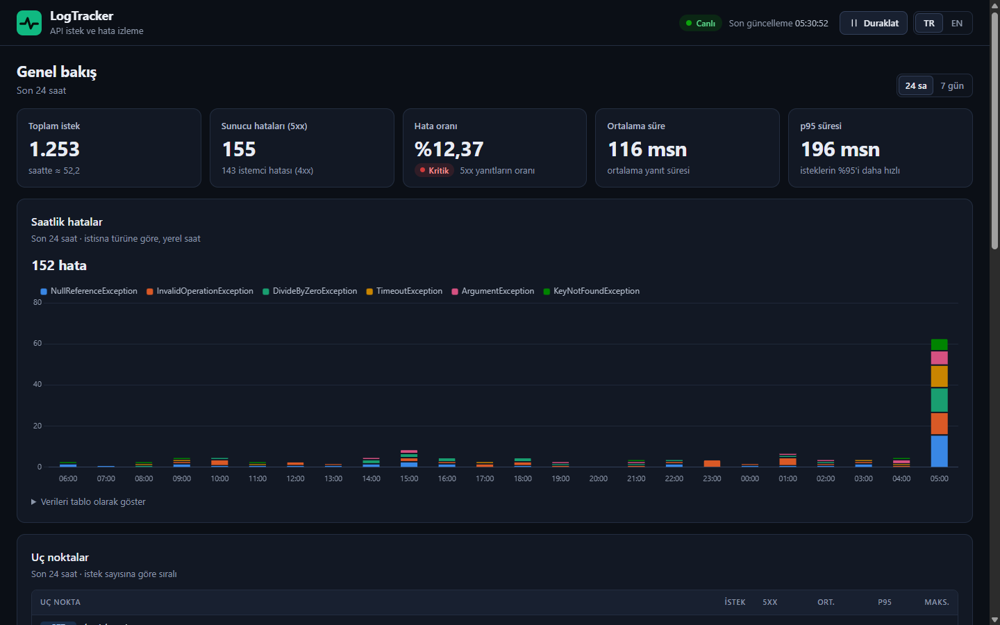
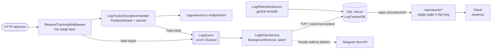
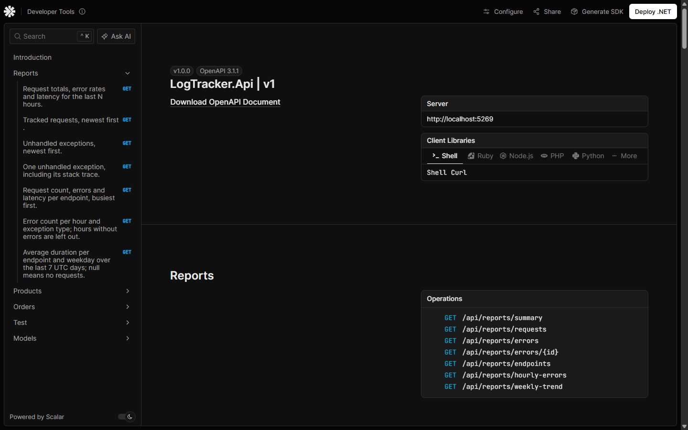

# LogTracker

**ASP.NET Core API'leri için istek süresi ölçümü, exception kaydı ve canlı raporlar. Veriler SQL Server'da tutulur.**

[](https://github.com/ibrahimceceli/LogTrackerAPI/actions/workflows/ci.yml)
[](https://dotnet.microsoft.com/)
[](LICENSE)

[English](README.md) · **Türkçe**



LogTracker, bir ASP.NET Core uygulamasına üç satırla eklenen küçük bir kütüphanedir. Her API isteğinin
süresini ölçer, yakalanmamış exception'ları stack trace'leriyle birlikte kaydeder, ikisini de arka planda
SQL Server'a yazar ve sonuçları bir rapor API'si ve canlı bir izleme paneli üzerinden sunar. İsteğe bağlı
Telegram bildirimleri bir şeyler bozulduğunda haber verir.

Repo; kütüphanenin kendisini, denemek için bir demo API'yi, bir trafik simülatörünü, SQL script'lerini,
testleri ve her şeyi tek komutla ayağa kaldıran bir Docker Compose ortamını içerir.

## Özellikler

- **İstek takibi**: her istek için HTTP metodu, route template (`/api/products/7` değil,
  `/api/products/{id:int}`), path, status code, süre ve W3C trace id.
- **Exception kaydı**: yakalanmamış exception'lar tipi, mesajı, oluştuğu sınıf ve tam stack trace ile
  saklanır; istemciye aynı `traceId`'yi taşıyan bir [ProblemDetails](https://www.rfc-editor.org/rfc/rfc9457)
  cevabı döner.
- **İstekleri asla yavaşlatmaz**: kayıtlar sınırlı kapasiteli bir bellek kuyruğuna girer, bir background
  service bunları table-valued parameter ile toplu (batch) olarak yazar. Veritabanı çökse bile istekler
  çalışmaya devam eder.
- **Rapor API'si**: hata oranı, ortalama ve p95 süreyi içeren özet, sayfalı istek ve hata listeleri,
  endpoint bazında istatistikler, saatlik hata sayıları ve `PIVOT` ile hazırlanan haftalık süre trendi.
- **Canlı panel**: koyu tema, mobil uyumlu, Türkçe/İngilizce, Chart.js grafikleri, 5 saniyede bir
  yenilenir. XSS'e karşı güvenli (tüm değerler metin olarak basılır, sıkı Content Security Policy).
- **Telegram bildirimleri**: yakalanmamış exception'lar için, HTML-escape edilmiş ve exception tipi
  başına sınırlandırılmış (throttling).
- **Bakım işleri**: günlük eski kayıt temizliği (retention), `/health` üzerinde veritabanı health check'i,
  raporlar için isteğe bağlı `X-Api-Key` koruması.
- **Çalıştırmaya hazır**: SQL Server ve demo verisiyle gelen Docker Compose ortamı, trafik simülatörü,
  unit/API/veritabanı testleri ve GitHub Actions CI.

## İçindekiler

- [Mimari](#mimari)
- [Docker ile hızlı başlangıç](#docker-ile-hızlı-başlangıç)
- [Docker olmadan yerelde çalıştırma](#docker-olmadan-yerelde-çalıştırma)
- [LogTracker'ı kendi uygulamanızda kullanma](#logtrackerı-kendi-uygulamanızda-kullanma)
- [Yapılandırma](#yapılandırma)
- [API referansı](#api-referansı)
- [Veritabanı](#veritabanı)
- [Testler ve CI](#testler-ve-ci)
- [Güvenlik notları](#güvenlik-notları)
- [Projenin hikâyesi](#projenin-hikâyesi)
- [Lisans](#lisans)

## Mimari



İstek önce tracking middleware'den geçer. Bu middleware exception handler'ı sarmaladığı için hatalı
isteklerin son status code'unu da görür. İkisi de yalnızca bellekteki kuyruğa kayıt ekler ve hemen
devam eder. `LogWriterService` kuyruğu okur ve her tablo için tek bir stored procedure çağrısıyla bütün
bir batch'i yazar. Kuyruk dolarsa yeni kayıtlar istekleri bekletmek yerine atılır ve sayılır. Uygulama
kapanırken kuyrukta kalanlar veritabanına yazılır.

### Proje yapısı

```text
LogTrackerAPI/
├── src/
│   ├── LogTracker.Core/        Yeniden kullanılabilir kütüphane: middleware, exception handler, kuyruk, yazıcı, raporlar, bildirimler
│   ├── LogTracker.Api/         Demo uygulama: ürün/sipariş endpoint'leri, test endpoint'leri, wwwroot'taki panel
│   └── LogTracker.Simulator/   API'ye gerçekçi demo trafiği gönderen konsol uygulaması
├── database/                   Tekrar çalıştırılabilir, numaralı SQL script'leri (tablolar, tipler, procedure'ler, demo verisi)
├── tests/
│   ├── LogTracker.Core.Tests/  Kütüphane için unit testler ve SQL Server testleri
│   └── LogTracker.Api.Tests/   WebApplicationFactory ile API testleri
├── docs/images/                README'lerdeki ekran görüntüleri
├── Dockerfile                  API ve simülatör imajları için multi-stage build
├── docker-compose.yml          SQL Server + şema + API (--profile demo ile simülatör de)
└── .github/workflows/ci.yml    Build, test, veritabanı testleri ve Docker smoke test
```

## Docker ile hızlı başlangıç

Yalnızca Docker Compose ile birlikte [Docker](https://docs.docker.com/get-docker/) gerekir. .NET SDK'ya
veya yerel bir SQL Server'a ihtiyaç yoktur.

```bash
git clone https://github.com/ibrahimceceli/LogTrackerAPI.git
cd LogTrackerAPI
cp .env.example .env
```

`.env` dosyasını açıp kendi `MSSQL_SA_PASSWORD` değerinizi yazın (büyük harf, küçük harf, rakam ve
sembolden en az üçünü içeren, en az 8 karakter; `;`, `'`, `"`, `$` ve boşluk kullanmayın). Ardından
ortamı başlatın:

```bash
docker compose up --build
```

Compose önce SQL Server'ı başlatır, sağlıklı olmasını bekler, `database/` klasöründeki script'leri
çalıştırır (panel boş görünmesin diye demo verisi de dahil) ve API'yi ayağa kaldırır. Trafik simülatörünü
de başlatmak için:

```bash
docker compose --profile demo up --build
```

| Ne | Nerede |
| --- | --- |
| Panel | <http://localhost:8080> |
| Rapor API'si | <http://localhost:8080/api/reports/summary> |
| Health check | <http://localhost:8080/health> |
| SQL Server (SSMS, Azure Data Studio, sqlcmd) | `127.0.0.1,14333`, kullanıcı `sa`, şifre `.env` dosyasından |

Tüm portlar yalnızca `127.0.0.1` adresine bağlanır. Portları `.env` içindeki `API_PORT` ve `DB_PORT` ile
değiştirebilirsiniz. Container'da uygulama Production ortamında çalıştığı için OpenAPI dokümanı ve Scalar
orada sunulmaz (bkz. [Yerelde çalıştırma](#docker-olmadan-yerelde-çalıştırma)).

Durdurma ve temizlik:

```bash
docker compose --profile demo down            # container'ları durdurur ve siler, veritabanı kalır
docker compose --profile demo down --volumes  # veritabanı volume'unu da siler
```

### `.env` ayarları

| Değişken | Varsayılan | Anlamı |
| --- | --- | --- |
| `MSSQL_SA_PASSWORD` | `LogTracker_Dev_2026` | `sa` kullanıcısının şifresi (zorunlu; kendinizinkini seçin) |
| `DB_PORT` | `14333` | SQL Server için host portu |
| `API_PORT` | `8080` | API ve panel için host portu |
| `LOGTRACKER_API_KEY` | boş | Doluysa `/api/reports/*` için `X-Api-Key` header'ı gerekir |
| `TELEGRAM_ENABLED` | `false` | Telegram bildirimlerini açar |
| `TELEGRAM_BOT_TOKEN` / `TELEGRAM_CHAT_ID` | boş | @BotFather'dan alınan bot token'ı ve bildirimin gideceği chat id |
| `SIMULATOR_CONCURRENCY` | `4` | Paralel istek gönderen sanal kullanıcı sayısı (1-50) |
| `SIMULATOR_MIN_DELAY_MS` / `SIMULATOR_MAX_DELAY_MS` | `200` / `1500` | Bir kullanıcının iki isteği arasındaki rastgele bekleme |
| `SIMULATOR_ERROR_PERCENT` | `10` | Hata fırlatan test endpoint'ine giden isteklerin yüzdesi |
| `SIMULATOR_DURATION_SECONDS` | boş | N saniye sonra durur; boşsa ortam durana kadar çalışır |
| `SIMULATOR_SUMMARY_INTERVAL_SECONDS` | `30` | Simülatör logundaki özetler arası saniye; `0` = yalnızca son özet |

`.env` git tarafından yok sayılır. Gerçek şifreleri veya token'ları asla commit etmeyin.

## Docker olmadan yerelde çalıştırma

### Gereksinimler

- [.NET 10 SDK](https://dotnet.microsoft.com/download) (sürüm `global.json` ile sabitlenmiştir)
- SQL Server 2019 veya üzeri ya da **SQL Server Express LocalDB** (Visual Studio ile birlikte gelir)
- Script'leri çalıştırmak için [`sqlcmd`](https://learn.microsoft.com/sql/tools/sqlcmd/sqlcmd-utility)

### 1. Veritabanını oluşturun

Development ayarları (`src/LogTracker.Api/appsettings.Development.json`) LocalDB'yi kullanır:

```text
Server=(localdb)\MSSQLLocalDB;Database=LogTrackerDB;Trusted_Connection=True;TrustServerCertificate=True
```

`LogTrackerDB` veritabanını oluşturun ve script'leri isim sırasıyla çalıştırın. Script'ler tekrar
çalıştırılabilir, yani yeni değişiklikleri çektikten sonra hepsini yeniden çalıştırabilirsiniz.
`90_seed_demo_data.sql` isteğe bağlıdır; yaklaşık bir haftalık demo trafiği ekler ve yalnızca tablolar
boşken çalışır.

PowerShell:

```powershell
sqlcmd -S "(localdb)\MSSQLLocalDB" -Q "IF DB_ID(N'LogTrackerDB') IS NULL CREATE DATABASE [LogTrackerDB];"
Get-ChildItem database\*.sql | Sort-Object Name | ForEach-Object { sqlcmd -S "(localdb)\MSSQLLocalDB" -d LogTrackerDB -b -I -i $_.FullName }
```

Bash:

```bash
sqlcmd -S "(localdb)\MSSQLLocalDB" -Q "IF DB_ID(N'LogTrackerDB') IS NULL CREATE DATABASE [LogTrackerDB];"
for f in database/*.sql; do sqlcmd -S "(localdb)\MSSQLLocalDB" -d LogTrackerDB -b -I -i "$f"; done
```

Başka bir SQL Server için `-S "(localdb)\MSSQLLocalDB"` yerine kendi sunucunuzu yazın (SQL login için
`-U`/`-P`, self-signed sertifikaya güvenmek için `-C` ekleyin).

### 2. Gizli ayarları yapılandırın (isteğe bağlı)

Yukarıdaki connection string LocalDB ile doğrudan çalışır. Diğer durumlarda ayarları repoya koymak yerine
[user secrets](https://learn.microsoft.com/aspnet/core/security/app-secrets) kullanın:

```bash
dotnet user-secrets set "ConnectionStrings:LogTrackerDb" "Server=localhost;Database=LogTrackerDB;User Id=...;Password=...;TrustServerCertificate=True" --project src/LogTracker.Api
dotnet user-secrets set "LogTracker:ApiKey" "uzun-ve-rastgele-bir-deger" --project src/LogTracker.Api
dotnet user-secrets set "LogTracker:Telegram:Enabled" "true" --project src/LogTracker.Api
dotnet user-secrets set "LogTracker:Telegram:BotToken" "123456:ABC..." --project src/LogTracker.Api
dotnet user-secrets set "LogTracker:Telegram:ChatId" "123456789" --project src/LogTracker.Api
```

### 3. API'yi çalıştırın

```bash
dotnet dev-certs https --trust        # bir kez; tarayıcı ve simülatör https://localhost'a güvensin diye
dotnet run --project src/LogTracker.Api --launch-profile https
```

| Ne | Nerede |
| --- | --- |
| Panel | <https://localhost:7292> |
| Scalar API referansı (yalnızca Development) | <https://localhost:7292/scalar> |
| OpenAPI dokümanı (yalnızca Development) | <https://localhost:7292/openapi/v1.json> |
| Düz HTTP | <http://localhost:5269> (`--launch-profile` verilmeden `dotnet run` da bunu kullanır) |

`src/LogTracker.Api/LogTracker.Api.http` dosyasında Visual Studio, Rider ve VS Code REST Client için hazır
istekler bulunur.



### 4. Simülatörle trafik üretin

İkinci bir terminalde:

```bash
dotnet run --project src/LogTracker.Simulator
```

Varsayılan hedef `https://localhost:7292`'dir. İşe yarar seçenekler (her birinin bir ortam değişkeni de
vardır):

```bash
dotnet run --project src/LogTracker.Simulator -- --base-url http://localhost:5269 --concurrency 8 --error-percent 20 --duration 60
dotnet run --project src/LogTracker.Simulator -- --help
```

| Seçenek | Ortam değişkeni | Varsayılan |
| --- | --- | --- |
| `--base-url <url>` | `SIMULATOR_BASE_URL` | `https://localhost:7292` |
| `--concurrency <n>` | `SIMULATOR_CONCURRENCY` | `4` (1-50) |
| `--min-delay <ms>` | `SIMULATOR_MIN_DELAY_MS` | `200` |
| `--max-delay <ms>` | `SIMULATOR_MAX_DELAY_MS` | `1500` |
| `--error-percent <0-100>` | `SIMULATOR_ERROR_PERCENT` | `10` |
| `--duration <seconds>` | `SIMULATOR_DURATION_SECONDS` | yok (Ctrl+C'ye kadar çalışır) |
| `--summary-interval <seconds>` | `SIMULATOR_SUMMARY_INTERVAL_SECONDS` | `30` (`0` = yalnızca son özet) |

Simülatör ürün ve sipariş endpoint'lerini (bazı bilinmeyen id'ler ve geçersiz siparişler dahil), yavaş
istekleri ve hata fırlatan test endpoint'lerini çağırır. Ctrl+C ile durur ve bir özet yazdırır. Çıkış
kodları: `0` başarılı, `1` API hiç cevap vermedi, `2` geçersiz seçenek. Renkleri kapatmak için
`NO_COLOR=1` ayarlayın.

## LogTracker'ı kendi uygulamanızda kullanma

`LogTracker.Core` bir class library'dir (NuGet'te yayınlanmıyor). Projeye referans verin, `database/`
içindeki `01`-`05` script'lerini kendi veritabanınızda çalıştırın ve üç çağrı ekleyin:

```xml
<ProjectReference Include="..\LogTracker.Core\LogTracker.Core.csproj" />
```

```csharp
using LogTracker.Core;

var builder = WebApplication.CreateBuilder(args);

// Tracking, exception handler, ProblemDetails, background writer, retention, alerts, health check.
builder.Services.AddLogTracker(builder.Configuration);

var app = builder.Build();

app.UseStaticFiles();    // optional; static files served before UseLogTracker are not tracked
app.UseLogTracker();     // request tracking + exception handler, before your endpoints

app.MapHealthChecks("/health");   // includes the "logtracker-database" check
app.MapLogTrackerReports();       // GET /api/reports/*

app.MapGet("/hello", () => "Hello!");

app.Run();
```

```json
{
  "ConnectionStrings": {
    "LogTrackerDb": "Server=...;Database=LogTrackerDB;..."
  },
  "LogTracker": {
    "RetentionDays": 30
  }
}
```

`MapLogTrackerReports()` bir `RouteGroupBuilder` döndürür; böylece raporları API key yerine (veya
ona ek olarak) kendi kimlik doğrulamanızla koruyabilirsiniz, örneğin
`app.MapLogTrackerReports().RequireAuthorization();`. Paneli göstermek için
`src/LogTracker.Api/wwwroot` içindeki `index.html`, `css/`, `js/` ve `lib/` öğelerini kendi `wwwroot`
klasörünüze kopyalayın ve `app.UseStaticFiles()` öncesinde `app.UseDefaultFiles()` çağırın.

Ayarlar uygulama açılırken doğrulanır: eksik connection string, geçersiz bir değer veya token ve chat id
olmadan açılmış Telegram, uygulamayı daha sonra hata vermek yerine açıklayıcı bir mesajla hemen durdurur.

## Yapılandırma

Connection string dışındaki tüm ayarlar `LogTracker` bölümündedir. Ortam değişkeni olarak yazarken `:`
yerine `__` (çift alt çizgi) kullanılır.

| Ayar | Varsayılan | Ortam değişkeni | Anlamı |
| --- | --- | --- | --- |
| `ConnectionStrings:LogTrackerDb` | (zorunlu) | `ConnectionStrings__LogTrackerDb` | SQL Server connection string'i |
| `LogTracker:ApiKey` | boş | `LogTracker__ApiKey` | Doluysa (en az 16 karakter) rapor istekleri `X-Api-Key: <değer>` göndermelidir; boş = herkese açık |
| `LogTracker:RetentionDays` | `30` | `LogTracker__RetentionDays` | Bundan eski kayıtlar açılışta ve sonra günde bir silinir |
| `LogTracker:ExcludedPathPrefixes` | aşağıya bakın | `LogTracker__ExcludedPathPrefixes__0`, `__1`, ... | Takip edilmeyecek ek path önekleri (varsayılanlara eklenir; `/` ile başlamalı) |
| `LogTracker:QueueCapacity` | `10000` | `LogTracker__QueueCapacity` | Yazılmayı bekleyebilecek kayıt sayısı; kuyruk doluysa yeni kayıtlar atılır |
| `LogTracker:BatchSize` | `500` | `LogTracker__BatchSize` | Veritabanına tek seferde gönderilen en fazla kayıt |
| `LogTracker:Telegram:Enabled` | `false` | `LogTracker__Telegram__Enabled` | Telegram bildirimlerini açar |
| `LogTracker:Telegram:BotToken` | boş | `LogTracker__Telegram__BotToken` | @BotFather'dan alınan bot token'ı (açıksa zorunlu) |
| `LogTracker:Telegram:ChatId` | boş | `LogTracker__Telegram__ChatId` | Bildirimlerin gideceği chat (açıksa zorunlu) |
| `LogTracker:Telegram:ThrottleSeconds` | `60` | `LogTracker__Telegram__ThrottleSeconds` | Bu süre içinde exception tipi başına en fazla bir bildirim; atlananlar bir sonrakinde belirtilir; `0` hepsini gönderir |
| `LogTracker:EnableTestEndpoints` | `false` | `LogTracker__EnableTestEndpoints` | Yalnızca demo API: `/api/test/*` endpoint'lerini açar (Development'ta ve Docker Compose'da açık) |

Varsayılan olarak hiç takip edilmeyen path'ler: `/api/reports`, `/health`, `/swagger`, `/openapi`,
`/scalar`, `/favicon.ico`, `/.well-known`. Başarıyla sunulan statik dosyalar da takip edilmez. Hiçbir
route ile eşleşmeyen istekler `(unmatched)` endpoint'iyle kaydedilir.

## API referansı

### Raporlar

Tüm rapor endpoint'leri `/api/reports` altında `GET` isteğidir. `LogTracker:ApiKey` ayarlıysa `X-Api-Key`
header'ı gerekir, aksi hâlde `401` döner. Geçersiz parametreler `ValidationProblemDetails` gövdesiyle
`400` döndürür. Zamanlar UTC'dir.

| Endpoint | Parametreler | Döndürdüğü |
| --- | --- | --- |
| `/api/reports/summary` | `hours` = 24 (1-8784) | Toplam istek, 4xx/5xx sayıları, hata oranı, ortalama ve p95 süre |
| `/api/reports/requests` | `page` = 1, `pageSize` = 20 (1-100) | Takip edilen istekler, en yeniden eskiye |
| `/api/reports/errors` | `page` = 1, `pageSize` = 20 (1-100) | Yakalanmamış exception'lar, en yeniden eskiye (stack trace olmadan) |
| `/api/reports/errors/{id}` | | Stack trace dahil tek bir exception; yoksa `404` |
| `/api/reports/endpoints` | `hours` = 168 (1-8784) | Metot ve route bazında istek sayısı, 5xx sayısı, ortalama/p95/en yüksek süre; en yoğundan başlar |
| `/api/reports/hourly-errors` | `hours` = 24 (1-8784) | Saat ve exception tipi bazında hata sayısı; hatasız saatler listelenmez |
| `/api/reports/weekly-trend` | | Son 7 UTC gününde endpoint ve haftanın günü bazında ortalama süre; `null` = o gün istek yok |

`GET /api/reports/summary?hours=24`

```json
{
  "from": "2026-10-29T02:29:06.1664706Z",
  "to": "2026-10-30T02:29:06.1664706Z",
  "totalRequests": 818,
  "serverErrorCount": 110,
  "clientErrorCount": 97,
  "errorRatePercent": 13.45,
  "averageDurationMs": 104.12,
  "p95DurationMs": 194.3
}
```

`GET /api/reports/requests?pageSize=1`

```json
{
  "items": [
    {
      "id": 4134,
      "method": "POST",
      "endpoint": "/api/orders",
      "path": "/api/orders",
      "statusCode": 201,
      "durationMs": 76,
      "traceId": "00-a513f83bb904e6be5ad680e0715694f0-42fdd0d207414973-00",
      "occurredAtUtc": "2026-10-30T02:29:06.049Z"
    }
  ],
  "page": 1,
  "pageSize": 1,
  "totalCount": 4134
}
```

`GET /api/reports/errors/1`

```json
{
  "id": 1,
  "type": "System.Collections.Generic.KeyNotFoundException",
  "message": "Simulated missing key.",
  "source": "LogTracker.Api.Endpoints.TestEndpoints",
  "method": "GET",
  "path": "/api/test/errors/key-not-found",
  "endpoint": "/api/test/errors/{type}",
  "statusCode": 500,
  "traceId": "00-fb422db204354a48aab19114c917f99a-c14c351391f14f28-00",
  "occurredAtUtc": "2026-10-26T03:30:23.261Z",
  "stackTrace": "System.Collections.Generic.KeyNotFoundException: Simulated missing key.\r\n   at LogTracker.Api.Endpoints.TestEndpoints.ThrowError(String type)"
}
```

`GET /api/reports/endpoints?hours=24` (ilk öğe)

```json
[
  {
    "method": "GET",
    "endpoint": "/api/products",
    "totalRequests": 226,
    "serverErrorCount": 0,
    "averageDurationMs": 44.26,
    "p95DurationMs": 76,
    "maxDurationMs": 84
  }
]
```

`GET /api/reports/hourly-errors?hours=24` (ilk öğe)

```json
[
  { "hourStartUtc": "2026-10-30T01:00:00Z", "errorType": "System.ArgumentException", "count": 2 }
]
```

`GET /api/reports/weekly-trend` (ilk öğe)

```json
[
  {
    "method": "POST",
    "endpoint": "/api/orders",
    "monday": 112.86,
    "tuesday": 110.91,
    "wednesday": 108.86,
    "thursday": 113.47,
    "friday": 132,
    "saturday": 109.01,
    "sunday": 104.1
  }
]
```

### Demo endpoint'leri

Bunlar demo uygulamaya (`LogTracker.Api`) aittir ve yalnızca trafik üretmek için vardır. Ürünler sabittir;
siparişler API yeniden başlayana kadar bellekte tutulur. Gerçek veritabanı çağrıları gibi davranmak için
birkaç milisaniye beklerler.

| Endpoint | Açıklama |
| --- | --- |
| `GET /api/products` | 20 örnek ürünün tamamı |
| `GET /api/products/{id}` | Tek ürün (id 1-20); değilse `404` |
| `POST /api/orders` | Gövde `{ "productId": 3, "quantity": 2 }`; `Location` header'ıyla `201`, bilinmeyen ürün veya 1-100 dışı adet için `400` |
| `GET /api/orders/{id}` | API başladıktan sonra oluşturulmuş bir sipariş; değilse `404` |
| `GET /health` | Veritabanına ulaşılabiliyor ve tablolar varsa `200 Healthy`, aksi hâlde `503 Unhealthy` |
| `GET /scalar`, `GET /openapi/v1.json` | API referansı ve OpenAPI dokümanı, **yalnızca Development** |

### Test endpoint'leri

Yalnızca `LogTracker:EnableTestEndpoints` değeri `true` olduğunda eklenir. `appsettings.json` içinde
`false`'tur; `appsettings.Development.json` ve Docker Compose'da açılır.

| Endpoint | Açıklama |
| --- | --- |
| `GET /api/test/errors/{type}` | Exception fırlatır: `invalid-operation`, `null-reference`, `divide-by-zero`, `timeout`, `argument` veya `key-not-found`; bilinmeyen tip `400` döndürür |
| `GET /api/test/slow?ms=1500` | Cevap vermeden önce `ms` milisaniye bekler (0-10000 ile sınırlı) |

Development dışında hata cevabı exception ayrıntılarını göstermez:

```json
{
  "type": "https://tools.ietf.org/html/rfc9110#section-15.6.1",
  "title": "An unexpected error occurred.",
  "status": 500,
  "traceId": "00-47851100f500ccfb1291d8536a376931-1d3b15b3acdc30ff-00"
}
```

Buradaki `traceId`, istek ve hata kaydıyla birlikte saklanan değerin aynısıdır; böylece bir kullanıcının
hata bildirimi paneldeki stack trace ile eşleştirilebilir.

## Veritabanı

| Script | İçerik |
| --- | --- |
| `01_tables.sql` | `RequestLogs` ve `ErrorEvents` tabloları (UTC `datetime2` zaman damgaları), `OccurredAtUtc` üzerinde covering index'ler |
| `02_table_types.sql` | Toplu ekleme için `RequestLogTableType` ve `ErrorEventTableType` tablo tipleri |
| `03_write_procedures.sql` | `InsertRequestLogs`, `InsertErrorEvents` (bütün batch'i table-valued parameter olarak alır) |
| `04_report_procedures.sql` | `GetRequestSummary`, `GetEndpointStats`, `GetHourlyErrorCounts`, `GetWeeklyTrend` |
| `05_retention_procedure.sql` | `PurgeOldLogs` |
| `90_seed_demo_data.sql` | İsteğe bağlı demo verisi: son 7 güne yayılmış 4000 istek ve bunlara ait hatalar; yalnızca iki tablo da boşsa |

Tüm script'ler güvenle tekrar çalıştırılabilir (`IF ... IS NULL` kontrolleri ve `CREATE OR ALTER`).
SQL Server 2019 veya üzeri gerekir; Docker Compose SQL Server 2022 kullanır. Sayfalı listeler uygulama
içinde ([Dapper](https://github.com/DapperLib/Dapper) ile) düz `SELECT ... OFFSET/FETCH` sorgularıdır;
toplu raporlar ise stored procedure'dür. Her zaman aralığı yarı açıktır (`>= @FromUtc AND < @ToUtc`),
p95 değerleri `PERCENTILE_CONT(0.95)` ile hesaplanır.

### Haftalık trend: dilden bağımsız bir PIVOT

`GetWeeklyTrend`, istek başına bir satırı endpoint başına yedi gün sütunlu tek bir satıra çevirir:

```sql
DECLARE @KnownMonday date = '19000101';  -- 1 January 1900 was a Monday

SELECT Method, Endpoint,
       ROUND([0], 2) AS Monday, ROUND([1], 2) AS Tuesday, ... ROUND([6], 2) AS Sunday
FROM
(
    SELECT Method, Endpoint,
           DATEDIFF(day, @KnownMonday, CAST(OccurredAtUtc AS date)) % 7 AS DayIndex,
           CAST(DurationMs AS float) AS DurationMs
    FROM dbo.RequestLogs
    WHERE OccurredAtUtc >= @FromUtc AND OccurredAtUtc < @ToUtc
) AS DailyDurations
PIVOT (AVG(DurationMs) FOR DayIndex IN ([0], [1], [2], [3], [4], [5], [6])) AS ByWeekday;
```

Alışılmış yöntem olan `DATENAME(weekday, ...)` veya `DATEPART(weekday, ...)` oturum ayarlarına bağlıdır:
`SET LANGUAGE Turkish` altında `DATENAME`, `Monday` yerine `Pazartesi` döndürür; `DATEPART` ise günleri
`SET DATEFIRST` değerine göre farklı numaralandırır. Bilinen bir pazartesiden itibaren gün saymak, dili ne
olursa olsun her sunucuda `0 = pazartesi ... 6 = pazar` sonucunu verir. Pencere, bugün dahil tam olarak son
yedi UTC takvim günüdür ve bir veritabanı testi procedure'ü `SET LANGUAGE Turkish; SET DATEFIRST 3;`
altında çalıştırarak bunu doğrular.

`GetHourlyErrorCounts` ise bilinçli olarak sabit sütunlu bir `PIVOT` yerine uzun format (saat ve exception
tipi başına bir satır) döndürür; böylece yeni exception tipleri SQL'e dokunmadan görünür.

### Retention (eski kayıt temizliği)

`LogRetentionService`, uygulama açılırken ve sonra her 24 saatte bir `PurgeOldLogs @RetentionDays`
çağırır. Procedure, `RetentionDays` (varsayılan 30) günden eski satırları 5000'lik parçalar hâlinde siler;
böylece büyük bir temizlik log yazıcısını uzun süre bekletmez.

## Testler ve CI

```bash
dotnet test
```

Bu komut unit testleri (`LogTracker.Core.Tests`) ve API testlerini (`LogTracker.Api.Tests`; bellek içi bir
log deposuyla `WebApplicationFactory` kullanır) çalıştırır. SQL Server testleri,
`LOGTRACKER_TEST_CONNECTION` **sunucu düzeyinde** bir connection string'e (veritabanı adı olmadan)
ayarlanmadıkça atlanır. Bu testler benzersiz isimli kendi veritabanlarını oluşturur, `database/`
içindeki gerçek script'leri çalıştırır ve sonunda veritabanını siler.

Docker Compose'daki SQL Server ile (PowerShell / Bash):

```powershell
$env:LOGTRACKER_TEST_CONNECTION = "Server=127.0.0.1,14333;User Id=sa;Password=<şifreniz>;TrustServerCertificate=True"
dotnet test --filter "Category=Database"
```

```bash
LOGTRACKER_TEST_CONNECTION="Server=127.0.0.1,14333;User Id=sa;Password=<şifreniz>;TrustServerCertificate=True" dotnet test --filter "Category=Database"
```

LocalDB ile: `Server=(localdb)\MSSQLLocalDB;Trusted_Connection=True;TrustServerCertificate=True`.

[GitHub Actions](.github/workflows/ci.yml) her push'ta, `main`'e açılan pull request'lerde ve elle
tetiklendiğinde üç job çalıştırır:

1. **Build and test**: `dotnet build -c Release -p:TreatWarningsAsErrors=true` ve `dotnet test`.
2. **Database tests**: SQL Server 2022 service container'ına karşı veritabanı testleri.
3. **Docker**: iki imajı da build eder, ortamı `.env.example` ile başlatır, `/health` ve
   `/api/products` adreslerini kontrol eder ve simülatörü 20 saniye çalıştırır.

## Güvenlik notları

- **Raporlar hassas veri içerebilir** (path'ler, exception mesajları, stack trace'ler). API'yi dışarı
  açmadan önce `LogTracker:ApiKey` ayarlayın ya da `MapLogTrackerReports()` üzerine kendi yetkilendirmenizi
  ekleyin. Anahtar sabit zamanlı (constant-time) karşılaştırılır. Panel gerektiğinde anahtarı sorar ve
  **API anahtarını unut** düğmesine basılana kadar tarayıcının `localStorage`'ında saklar. API key ortak
  bir sırdır; uygulamayı HTTPS üzerinden sunun.
- **Test endpoint'leri varsayılan olarak kapalıdır.** Yalnızca `LogTracker:EnableTestEndpoints` değeri
  `true` olduğunda eklenir (Development ayarları ve Docker demo ortamı).
- **Production cevaplarında exception ayrıntısı yoktur.** ProblemDetails yalnızca Development ortamında
  exception mesajını içerir; tam metin veritabanında saklanır.
- **Repoda gizli bilgi yoktur.** Şifre içeren connection string'ler, API key ve Telegram token'ı user
  secrets'ta, ortam değişkenlerinde veya `.env` dosyasında (git tarafından yok sayılır) durmalıdır. Bot
  token'ı istek URL'sinin bir parçası olduğu için Telegram HTTP client'ının istek logları kapatılmıştır.
- **XSS'e karşı güvenli panel.** API'den gelen her değer `textContent` ile basılır ve sıkı bir Content
  Security Policy inline script'leri engeller. Telegram mesajları da HTML-escape edilir.
- **Güvenlik başlıkları.** Demo API her yanıtta `X-Content-Type-Options: nosniff`, `X-Frame-Options: DENY`,
  `Referrer-Policy: no-referrer` ve `Content-Security-Policy: frame-ancestors 'none'` gönderir; `Server`
  başlığını göndermez. 16 karakterden kısa bir API key uygulamanın açılmasını engeller.
- **Docker varsayılanları**: portlar `127.0.0.1` adresine bağlanır, API ve simülatör container'ları
  yetkisiz `app` kullanıcısıyla çalışır. `.env.example` içindeki varsayılan `MSSQL_SA_PASSWORD` yalnızca
  yerel demolar içindir.

## Projenin hikâyesi

LogTracker, 2026'daki stajımda geliştirdiğim bir proje olarak başladı: istek sürelerini ve exception'ları
ADO.NET ve stored procedure'lerle SQL Server'a kaydeden, bunları `PIVOT` sorgularıyla (saatlik hata
matrisi ve haftalık performans trendi) raporlayan, Telegram bildirimi gönderen ve her şeyi küçük bir HTML
sayfasında gösteren bir ASP.NET Core Web API.

Yayınlamadan önce projeyi gözden geçirip yeniden yapılandırdım. Fikirler aynı kaldı, uygulama olgunlaştı:

- **Yeniden kullanılabilir kütüphane**: takip kodu `AddLogTracker` / `UseLogTracker` /
  `MapLogTrackerReports` ile `LogTracker.Core`'a taşındı, demo uygulama ince bir host'a dönüştü.
- **Asenkron log hattı**: her isteğin içinde veritabanına yazmak yerine kayıtlar sınırlı bir `Channel`
  üzerinden, batch'leri table-valued parameter ile ekleyen bir background writer'a gider.
- **Dayanıklı loglama**: yavaş veya erişilemeyen bir veritabanı artık istekleri etkilemiyor; hatalar
  loglanıyor, `/health` veritabanının durumunu bildiriyor ve kapanışta kuyruk boşaltılıyor.
- **Daha iyi veri**: ham path yerine route template, status code, trace id, UTC zaman damgaları, p95
  süre ve artık sunucu diline bağlı olmayan bir `PIVOT`.
- **Paneldeki XSS düzeltmesi ve yeni tasarım**: eski sayfa API değerlerinden `innerHTML` ile HTML
  üretiyordu; yeni iki dilli panel metni güvenli şekilde basıyor, Chart.js kullanıyor ve telefonda da
  çalışıyor.
- **Modern hata yönetimi**: `IExceptionHandler` + ProblemDetails, production'da exception ayrıntısı yok,
  HTML-escape edilmiş ve throttle edilmiş Telegram bildirimleri, kodun dışına taşınmış gizli bilgiler.
- **Testler, Docker ve CI**: xUnit unit, API ve veritabanı testleri, tek komutluk Docker Compose demosu ve
  GitHub Actions; yerleşik OpenAPI ve Scalar ile .NET 8'den .NET 10'a yükseltme.

## Lisans

[MIT Lisansı](LICENSE) ile yayınlanmıştır. Chart.js kendi
[MIT lisansı](src/LogTracker.Api/wwwroot/lib/chartjs/LICENSE.md) altında dahil edilmiştir.
